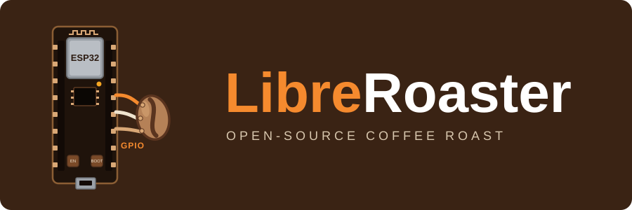

# ☕🔥 LibreRoaster

  

**Open-source coffee-roaster firmware for the ESP32-C3, written in Rust.**

LibreRoaster exposes a TC4-compatible serial interface so [Artisan](https://artisan-scope.org/)
can read two thermocouple channels and control a heater and fan. The firmware runs the device-side
control loop, telemetry, and safety interlocks; Artisan owns the roast session and the operator UI.

Use the ESP32-C3's **native USB port** for the normal Artisan connection. If you build a custom
board, add a **10 kΩ pull-up from GPIO9 to 3.3 V** for reliable boot; official development boards
already include it. See [`docs/CONNECTION_TYPES.md`](docs/CONNECTION_TYPES.md) for the trade-offs.

**Why LibreRoaster exists →** Read the [Project Philosophy](docs/PHILOSOPHY.md).

## 🚧 Project Status

**v0.0.1 Alpha** — development on `develop`.

| Milestone | Status |
|---|---|
| Firmware builds for ESP32-C3 | ✅ Verified |
| Firmware flashes and boots on ESP32-C3 | ✅ Verified on hardware |
| Host test suite | ✅ Green; see [`docs/DEVELOPMENT.md`](docs/DEVELOPMENT.md) |
| TC4-compatible serial protocol | ✅ Implemented and tested synthetically |
| PID, profiles, and safety interlocks | ✅ Implemented and tested synthetically |
| Wokwi F1/F2/F3/F4/F5 simulation | ✅ Available; see [`docs/SIMULATION.md`](docs/SIMULATION.md) |
| Artisan 4.0.2 against Wokwi | ✅ TC4 handshake, `READ`, `START`, and a 696 s F4 roast validated |
| Real Artisan session on hardware | ⏳ Pending |
| Real thermocouple, fan, and heater integration | ⏳ Pending |
| Real coffee roast | ⏳ Pending |

Host tests and simulated-sensors runs do not prove electrical safety. The hardware integration
paths still need real bench validation.

## 🚀 Quick Start

1. Read [`docs/DEVELOPMENT.md`](docs/DEVELOPMENT.md) for toolchain, build, flash, and test commands.
2. Connect the board over native USB CDC and configure Artisan with
   [`docs/ARTISAN_CONNECTION.md`](docs/ARTISAN_CONNECTION.md).
3. Before first power-on with a real heater, complete
   [`docs/preflight-check.md`](docs/preflight-check.md).

For a no-hardware check, start with [`docs/SIMULATION.md`](docs/SIMULATION.md). To inspect or
change the firmware, use [`docs/FEATURE_MAP.md`](docs/FEATURE_MAP.md).

## 📚 DOCUMENTATION

| Section | Document |
|---|---|
| Hardware model | [`docs/HARDWARE_MODEL.md`](docs/HARDWARE_MODEL.md) |
| Serial protocol surface | [`docs/SERIAL_PROTOCOL_SURFACE.md`](docs/SERIAL_PROTOCOL_SURFACE.md) |
| Runtime architecture | [`docs/RUNTIME_ARCHITECTURE.md`](docs/RUNTIME_ARCHITECTURE.md) |
| Current technical baseline | [`docs/CURRENT_TECHNICAL_BASELINE.md`](docs/CURRENT_TECHNICAL_BASELINE.md) |

The full documentation index is [`docs/README.md`](docs/README.md). It lists the owner document
for every topic, including architecture and the control loop, the wire protocol and STATUS
semantics, Artisan setup and roast workflows, hardware and wiring, development, simulation, and
safety evidence.

## ⚠️ Safety Warning

LibreRoaster controls mains-adjacent, high-temperature hardware. Improper handling can cause
severe injury, fire, or death.

- Do not treat a passing build or test suite as proof of electrical safety.
- Do not run the roaster unattended.
- Disconnect power before modifying or servicing the device.
- Use appropriate insulation, fusing, grounding, and thermal protection.
- Keep a fire extinguisher nearby and work in a fire-safe, ventilated area.
- Treat watchdog, thermal cutoff, and heat-detection logic as last-resort mitigations, not as
  substitutes for safe hardware design.

You build and use this project at your own risk. The authors and contributors are not responsible
for damage, injury, or loss.

## 🔮 Hardware Roadmap

A complete DIY drum-roaster build guide is planned. It will cover the bill of materials, mechanical
and electrical assembly, and a validated reference build. Until then, the firmware and its
documented pin map are the stable part of the project.

## 📜 License

Apache 2.0. See [`LICENSE`](LICENSE).
