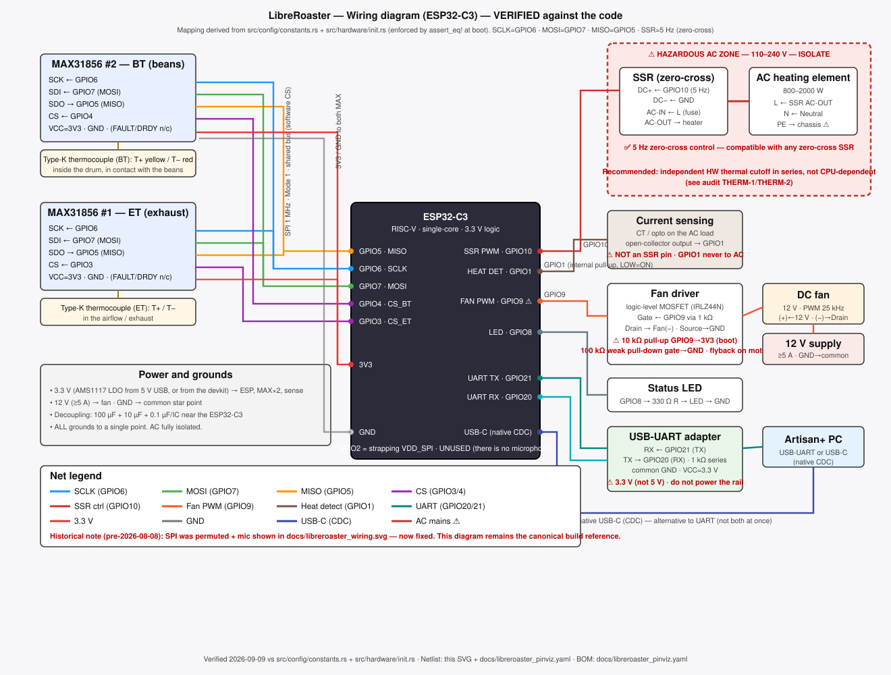

# LibreRoaster ESP32-C3 Pinout & Connection Diagram

**Last updated:** 2026-10-22 — firmware pin map and wiring references reviewed against `src/config/constants.rs` and `src/hardware/init.rs`.

## Overview

Pin assignments for the LibreRoaster coffee roaster firmware running on **ESP32-C3** (RISC-V). All pins are optimized for the ESP32-C3's capabilities and the coffee roaster application requirements.

## Pin Allocation Table

| GPIO  | Function              | Direction | Peripheral          | Notes / Warnings                                |
|-------|-----------------------|-----------|---------------------|-------------------------------------------------|
| 1     | Heat Detection        | Input     | SSR feedback        | Internal pull-up enabled. Reads LOW when SSR conducts. |
| 2     | *(not used)*          | —         | —                   | **Strapping pin. Must be avoided.** Conflicts with FSPIQ. |
| 3     | MAX31856 #1 CS        | Output    | Thermocouple ET     | Chip Select for Environment Temperature sensor. Shared SPI bus. |
| 4     | MAX31856 #2 CS        | Output    | Thermocouple BT     | Chip Select for Bean Temperature sensor. Shared SPI bus. |
| 5     | SPI MISO              | Input     | SPI (GPIO Matrix)   | Routed via GPIO Matrix because GPIO2 (native FSPIQ) is a strapping pin. |
| 6     | SPI SCLK              | Output    | SPI (FSPICLK)       | Serial Clock — shared between both MAX31856 chips. |
| 7     | SPI MOSI              | Output    | SPI (FSPID)         | Master Out Slave In — shared between both MAX31856 chips. |
| 8     | Status LED            | Output    | Onboard indicator   | Push-pull output only, never open-drain. Not sampled for normal flash boot. |
| 9     | **Fan PWM**           | Output    | LEDC (25 kHz)       | **⚠️ STRAPPING PIN (boot mode select).** Internal pull-up; see warning below. |
| 10    | SSR PWM               | Output    | LEDC (5 Hz, zero-cross compatible) | Heater control via Solid State Relay. |
| 20    | UART RX               | Input     | UART0               | Receives Artisan commands. Connect to CH341 TX. |
| 21    | UART TX               | Output    | UART0               | Sends Artisan telemetry. Connect to CH341 RX. |
| —     | USB D+ / D−           | Bidir     | USB Serial/JTAG     | Internal to ESP32-C3. Native USB CDC for Artisan (alternative to UART). No external pins. |

## Connection Diagram

```
┌─────────────────────────────────────────────────────────────────────┐
│                          ESP32-C3                                   │
│                                                                     │
│  ┌──────┐  ┌──────┐  ┌──────┐  ┌──────┐  ┌──────┐  ┌──────┐       │
│  │ GP1  │  │ GP3  │  │ GP4  │  │ GP5  │  │ GP6  │  │ GP7  │       │
│  │ DET  │  │ ET_CS│  │ BT_CS│  │MISO  │  │SCLK  │  │MOSI  │       │
│  └──┬───┘  └──┬───┘  └──┬───┘  └──┬───┘  └──┬───┘  └──┬───┘       │
│     │         │         │         │         │         │            │
│     │    ┌────┴─────────┴─────────┴─────────┴─────────┘            │
│     │    │              Shared SPI Bus                              │
│     │    │  ┌──────────────────────────────────┐                    │
│     │    │  │  MAX31856 #1 (ET)    MAX31856 #2 (BT)                │
│     │    │  │  CS=GP3              CS=GP4                          │
│     │    │  └──────────────────────────────────┘                    │
│     │    │         ▲                               ▲               │
│     │    │         │                               │               │
│     │    │    ┌────┴────┐                   ┌──────┴────┐          │
│     │    │    │ Type-K  │                   │  Type-K   │          │
│     │    │    │Thermo-  │                   │ Thermo-   │          │
│     │    │    │couple   │                   │ couple    │          │
│     │    │    │(ET)     │                   │ (BT)      │          │
│     │    │    └─────────┘                   └───────────┘          │
│     │    │                                                         │
│  ┌──┴────┴─────────────────────────────────────────────────────┐   │
│  │                    Power / Load Side                         │   │
│  │                                                              │   │
│  │  ┌──────┐  ┌──────┐  ┌──────┐  ┌──────┐                     │   │
│  │  │ GP9  │  │ GP10 │  │ GP1  │  │ GP8  │                     │   │
│  │  │FAN   │  │ SSR  │  │ HT   │  │ LED  │                     │   │
│  │  │PWM   │  │ PWM  │  │ DET  │  │ STATUS│                    │   │
│  │  └──┬───┘  └──┬───┘  └──┬───┘  └──────┘                     │   │
│  │     │         │         │                                    │   │
│  │     ▼         ▼         │                                    │   │
│  │  ╔═══╗   ┌─────────┐   │   ╔══════════════╗                 │   │
│  │  ║FAN║   │  SSR    │   └───║ SSR feedback  ║                 │   │
│  │  ║MOTOR║  │(Solid   │       ║(load detect) ║                 │   │
│  │  ║  ~  ║  │ State   │       ╚══════════════╝                 │   │
│  │  ╚═══╝   │ Relay)  │                                         │   │
│  │          │         │                                         │   │
│  │          │   ╔═╗   │       ╔══════════════╗                  │   │
│  │          │   ║ ║   │       ║ Heater       ║                  │   │
│  │          │   ║ ║ ←─┼───────║ Element      ║                  │   │
│  │          │   ╚═╝   │       ║  (AC Load)   ║                  │   │
│  │          └─────────┘       ╚══════════════╝                  │   │
│  │                                                              │   │
│  └──────────────────────────────────────────────────────────────┘   │
│                                                                     │
│  ┌──────────────────────────────────────────────────────────────┐   │
│  │                  Communication Side                          │   │
│  │                                                              │   │
│  │  ┌──────┐  ┌──────┐                                         │   │
│  │  │ GP20 │  │ GP21 │     ┌──────────────────┐                │   │
│  │  │UART  │  │UART  │     │  USB (native)    │                │   │
│  │  │ RX   │  │ TX   │     │  D+ / D−         │                │   │
│  │  └──┬───┘  └──┬───┘     │  (internal)      │                │   │
│  │     │         │         └──────────────────┘                │   │
│  │     │         │                                              │   │
│  │     ▼         ▼                                              │   │
│  │  ┌───────────────┐    ┌───────────────┐                     │   │
│  │  │  CH341 TX     │    │  CH341 RX     │                     │   │
│  │  │  (USB→UART)   │    │  (USB→UART)   │                     │   │
│  │  └───────────────┘    └───────────────┘                     │   │
│  │                                                              │   │
│  │    Artisan+ can connect via EITHER:                          │   │
│  │      • UART0 (GPIO20/21) — needs external USB-UART adapter  │   │
│  │      • USB CDC (native) — direct USB cable, no adapter      │   │
│  │                                                              │   │
│  └──────────────────────────────────────────────────────────────┘   │
└─────────────────────────────────────────────────────────────────────┘
```

## Wiring Diagrams

Full pin-to-pin build reference:



[Fritzing version](diagrams/wiring-diagram_fritzing.svg) — same circuit, breadboard style.

### Subsystem diagrams

| Subsystem | Diagram |
|---|---|
| Thermocouples and MAX31856 | [SVG](diagrams/libreroaster_sub_termopares_en.svg) · [Fritzing](diagrams/libreroaster_sub_termopares_fritzing_en.svg) |
| Fan / motor stage | [SVG](diagrams/libreroaster_sub_motor_ventilador_en.svg) · [Fritzing](diagrams/libreroaster_sub_motor_ventilador_fritzing_en.svg) |
| SSR and heater | [SVG](diagrams/libreroaster_sub_ssr_calentador_en.svg) · [Fritzing](diagrams/libreroaster_sub_ssr_calentador_fritzing_en.svg) |
| Power and communication | [SVG](diagrams/libreroaster_sub_alimentacion_comms_en.svg) · [Fritzing](diagrams/libreroaster_sub_alimentacion_comms_fritzing_en.svg) |

The diagrams are checked against the firmware constants. They do not replace the safety notes
below or the first-power-on checklist in [`preflight-check.md`](preflight-check.md).

## Assembly Order

Assemble and verify one subsystem at a time:

1. **Power and communication** — verify startup and both transport paths.
2. **Thermocouples** — verify readings before any heat is possible.
3. **Fan / motor** — verify the PWM sweep and safe boot behavior.
4. **SSR and heater** — verify control at duty 0 %, then with a safe load.
5. **Full wiring** — run the host tests and a dry run of the HIL scripts under `tests/hardware/`.
6. **AC mains last** — with the heater isolated, an extinguisher nearby, and the enclosure closed.

## Special Pin Warnings

### ⚠️ GPIO9 — Fan PWM (Strapping Pin: Boot Mode Select)

**This is the most critical pin on the board.**

| Property          | Value                        |
|-------------------|------------------------------|
| Strapping Role    | **Boot mode / download select** (Espressif: GPIO9 = boot-mode selector; “ULW” is not a real ESP32-C3 function name) |
| Boot Effect       | Pulled LOW → ESP32-C3 enters **download/bootstrap mode** |
| Normal Operation  | LEDC PWM output (25 kHz) for fan speed control |
| Risk              | If the fan driver circuit pulls GPIO9 low **during power-on reset**, the chip will not boot. |
| Internal pull-up  | GPIO9 has a **45 kΩ internal weak pull-up** (Espressif datasheet value — hardware guidance, not configured or verified by the firmware); left completely unconnected it latches HIGH and the chip boots normally. On custom boards the external 10 kΩ pull-up below is still **mandatory** — the fan-driver circuitry can overpower the weak internal pull-up during reset. |

**Required mitigations:**
1. **External pull-up resistor (10 kΩ to 3.3V)** on the GPIO9 line — mandatory.
2. The fan driver (e.g., MOSFET gate driver, motor controller) must be **high-impedance or tri-stated during ESP32-C3 reset**.
3. If using an N-channel MOSFET fan driver, add a pull-up between GPIO9 and the MOSFET gate, or use a series resistor + pull-up to ensure the gate is not floating low during boot.
4. Do **not** use a capacitive load >50 pF on this pin — it can delay the strapping level sampling.

**Failure symptom:** ESP32-C3 does not boot; enters serial download mode instead. Monitor with:
```bash
cargo espflash monitor
```
If you see "waiting for download" instead of the application running, GPIO9 is being pulled low at boot. (Firmware log output — including the startup banner — goes to UART0, not the USB-Serial-JTAG port, and `info!` lines are filtered out unless the build enables the `instrumentation` feature.)

---

### ⚠️ GPIO10 — SSR (heater)

GPIO10 has no defined level between reset and firmware initialisation (a few hundred ms) and after every watchdog reset. **A 10 kΩ pull-down from the SSR control line to GND is mandatory**, especially when the SSR is driven through a transistor/MOSFET. Bench check: scope GPIO10 during boot — it must never go HIGH before the firmware drives it.

---

### ⚠️ GPIO8 — Status LED (Not a Boot-Strapping Pin)

GPIO8 is **not** sampled during normal flash boot — the boot mode control
ignores it in SPI-boot mode, so a LOW level on GPIO8 cannot stop the firmware
from running. It only matters in **download mode**, where the combination
GPIO8=HIGH + GPIO9=LOW is used; GPIO8=0 + GPIO9=0 is invalid.

| Property          | Value                        |
|-------------------|------------------------------|
| Strapping Role    | None for normal flash boot (only the download-mode combo uses it) |
| Boot Effect       | Ignored in SPI boot mode; no “JTAG gear mode” behavior exists on the C3 |
| Normal Operation  | Output driving status LED    |

**Required mitigation:**
- Configure as **push-pull output** only. Never use open-drain.
- The LED circuit must **not** pull this pin low during boot. If the LED is connected between GPIO8 and GND (with series resistor), this is safe because `Output::new()` drives HIGH after initialization.
- If connecting an external transistor driver, ensure it is off (high-Z) during power-up.

---

### ⚠️ GPIO2 — FSPIQ (Strapping Pin — NOT USED)

| Property          | Value                        |
|-------------------|------------------------------|
| Strapping Role    | Boot-mode strap (must float/high at reset; legacy ESP32 name "VDD_SPI" does not apply to the C3) |
| Boot Effect       | Determines SPI flash voltage (1.8V vs 3.3V) |
| Status            | **Deliberately avoided** in this design |

SPI MISO is routed through **GPIO5 via the GPIO Matrix** instead of using the native FSPIQ (GPIO2). This avoids the strapping conflict entirely. Do not connect anything to GPIO2.

---

### ⚠️ GPIO1 — Heat Detection (SSR Feedback)

| Property          | Value                        |
|-------------------|------------------------------|
| Pull Configuration| Internal **pull-up enabled** |
| Normal Operation  | Reads **LOW** when SSR is conducting (heater ON) |
|                   | Reads **HIGH** when SSR is off (heater OFF) |

**Notes:**
- The internal pull-up ensures a known state when the SSR is disconnected.
- If the SSR feedback output is open-collector, no external pull-up is needed.
- If using an optocoupler for feedback, connect the transistor output between GPIO1 and GND.

---

### SPI Bus Notes (GPIO5, GPIO6, GPIO7)

The SPI bus is shared between two MAX31856 thermocouple amplifiers:

| Signal | GPIO | MAX31856 Pin |
|--------|------|--------------|
| SCLK   | 6    | SCK          |
| MOSI   | 7    | SDI          |
| MISO   | 5    | SDO          |
| CS_ET  | 3    | CS           |
| CS_BT  | 4    | CS           |

- **GPIO5 (MISO)** is used instead of GPIO2 (native FSPIQ) because GPIO2 is a strapping pin.
- The SPI runs at **1 MHz** in Mode 1 (CPOL=0, CPHA=1).
- Chip selects (GPIO3, GPIO4) are driven by regular GPIO, not hardware CS — ensure both default HIGH after boot.

---

### Communication Pins (GPIO20, GPIO21)

| Signal | GPIO | Direction | Connection |
|--------|------|-----------|------------|
| UART RX | 20  | Input     | CH341 TX   |
| UART TX | 21  | Output    | CH341 RX   |

- Baud rate: **115200**
- Both UART and native USB CDC are available. Artisan can connect through either path.
- No pull-up/pull-down resistors needed — the CH341 and ESP32-C3 handle line levels.

---

## Pin Group Summary

```
SPI Bus (MAX31856 thermocouples)
  GPIO6  ── SCLK
  GPIO7  ── MOSI
  GPIO5  ── MISO
  GPIO3  ── CS (ET sensor)
  GPIO4  ── CS (BT sensor)

PWM Outputs (LEDC)
  GPIO9  ── Fan PWM  (25 kHz)  ⚠️ STRAPPING PIN
  GPIO10 ── SSR 5 Hz (zero-cross compatible)

Feedback / Detection
  GPIO1  ── SSR heat detection (input, pull-up)

Status
  GPIO8  ── Status LED (output, push-pull) — not sampled for normal boot

Communication
  GPIO20 ── UART RX (Artisan in)
  GPIO21 ── UART TX (Artisan out)
  USB    ── USB CDC (native, alternative to UART)

NOT USED (avoid connecting anything)
  GPIO2  ── FSPIQ strapping pin — do not use
```

## Power Supply Notes

| Rail   | Voltage | Typical Current | Notes |
|--------|---------|-----------------|-------|
| VDD    | 3.3V    | 200–500 mA      | Regulated from USB or external supply |
| Heater | 120/230V AC | 5–15 A     | **DANGER: High voltage.** Always disconnect when modifying wiring. |
| Fan    | 12V DC  | 0.1–0.5 A       | Powered from separate supply, switched via MOSFET driven by GPIO9 |

- The ESP32-C3, MAX31856, and CH341 run on **3.3V**.
- The SSR heater and fan motor require **separate, isolated power supplies**.
- Ensure the 3.3V supply can deliver at least 200 mA to cover the ESP32-C3 + both MAX31856 chips + CH341.

## Safety Warnings

### High Voltage ⚡
- The SSR controls **mains AC voltage** (120V/230V). Always disconnect power before working on wiring.
- The heater element can exceed **260°C**. Risk of fire and severe burns.
- Never leave the roaster unattended while operating.

### GPIO9 Strapping Pin
- **CRITICAL:** GPIO9 is sampled on reset. If pulled low, the chip will **not boot**.
- An **external 10 kΩ pull-up to 3.3V** on the GPIO9 line is **mandatory**.
- Verify with an oscilloscope that GPIO9 is >2.5V during the first 1 ms after power-on.

### Fan Driver Compatibility
- If using a MOSFET to drive the fan, the GPIO9 line itself must be pulled
  UP (boot strap). Note the divider math honestly: 10 kΩ pull-up + 1 kΩ
  series + 100 kΩ gate pull-down puts the gate at ≈2.97 V while GPIO9 is
  HIGH — enough to turn a logic-level MOSFET ON, so the fan normally
  **runs during boot**. That is the safe direction (airflow with no heat);
  a guaranteed-OFF-at-boot needs an inverted driver stage, not a stronger
  pull-down (which would break the strap).
- **Solution:** Add both a pull-up (10 kΩ to 3.3V) on the GPIO9 line **and** a **weak** pull-down (100 kΩ to GND) on the MOSFET gate side, separated by a series resistor (1 kΩ) from GPIO9 to the gate.

```
        ┌──────────────────────┐
GPIO9 ──┤ 1kΩ                 │──── MOSFET Gate
        │         10kΩ         │
        │ ┌─────/\/\/\/── 3.3V │  (pull-up ensures boot OK)
        │ │                    │
        │ └─────/\/\/\/── GND  │  (weak pull-down: defined level when GPIO9 is Hi-Z; fan normally runs at boot — safe direction)
        └──────────────────────┘
```

- **Why 100 kΩ (weak):** a 10 kΩ gate pull-down would load the GPIO9 strap divider down to ≈1.9 V — below the ≈2.5 V boot threshold; 100 kΩ keeps GPIO9 ≈3.0 V at reset while still holding the gate near GND.

### Thermocouple Polarity
- Type-K thermocouples are polarity-sensitive. Reversing leads produces inverted (negative) temperature readings.
- Yellow = positive (+), Red = negative (−) for Type-K connectors.

---

## Detailed Build Notes

### Passives and decoupling

- GPIO9: 10 kΩ pull-up to 3.3 V, 1 kΩ series to the MOSFET gate, and a weak 100 kΩ gate pull-down.
  The divider puts the gate at ≈3.0 V at reset, so a logic-level fan MOSFET may run during boot.
  That is the safe direction: airflow with no heat. A guaranteed-off fan needs an inverted driver,
  not a stronger pull-down that would break the strap.
- GPIO10: 10 kΩ pull-down to GND; the line must never be HIGH before firmware drives it.
- GPIO8 LED: 330 Ω series resistor (≈3.9 mA at a 2.0 V LED drop).
- UART lines: 1 kΩ series resistors recommended, plus 3.3 V clamping on any 5 V adapter.
- Decoupling: 100 µF bulk plus 10 µF and 0.1 µF ceramics near the ESP32-C3 and each MAX31856.

### SPI bus

- Shared SCLK=GPIO6, MOSI=GPIO7, MISO=GPIO5 on the ESP32-C3 side.
- Separate chip selects: BT=GPIO4, ET=GPIO3. Both must default HIGH after boot.
- 1 MHz, mode 1 (CPOL=0, CPHA=1), software chip select.
- FAULT and DRDY are not wired; the firmware waits 210 ms for each one-shot conversion.
- Keep the MISO run short and return it to GPIO5, not GPIO2. Both chip selects must never be LOW
  together.

### Fan stage

- GPIO9 → LEDC channel 0 / timer 1 at 25 kHz.
- Use a logic-level N-channel MOSFET such as IRLZ44N in low-side switching; the IRF520 is not a
  reliable 3.3 V logic-level part.
- Gate: 1 kΩ series stopper, 100 kΩ weak pull-down, and the mandatory 10 kΩ boot pull-up.
- Flyback: Schottky diode such as SS34 or 1N5819 across the motor terminals. A 1N4007 is far too
  slow for 25 kHz PWM.
- Confirm the fan is safe when it runs at boot. Do not add a pull-down strong enough to break the
  GPIO9 boot strap.

### SSR and heater

- GPIO10 → LEDC channel 1 / timer 0 at 5 Hz, zero-cross time proportioning.
- Compatible with zero-cross SSRs such as SSR-25DA. Fit a mains fuse, a hardware thermal cutoff
  (klixon or thermal fuse) in series with the heater, a heatsink sized for the load, and protective
  earth to the metal chassis.
- The SSR minimum duty is one AC half-cycle; very small `OT1` requests snap to zero. Use a duty
  high enough to be observable when checking the heat-sense circuit.
- Heat detection is opt-in via the `heat-sense` feature. A bare AC optocoupler is not sufficient:
  stretch the pulse so GPIO1 stays LOW for the whole conduction time. See
  [`HARDWARE.md`](HARDWARE.md) §8.

### Power rails and star ground

- 3.3 V logic rail: regulated, 3.3 V ±5 %, at least 200 mA available.
- Fan rail: separate 12 V supply sized for the motor; do not back-power the logic rail.
- Star ground at one point; keep mains and logic returns physically separated.
- Native USB-C is the default communication path; the optional UART adapter must be 3.3 V.
- Both transports are listened to, but the multiplexer latches one active channel and resets after
  60 s idle. See [`CONNECTION_TYPES.md`](CONNECTION_TYPES.md) §6.

### Status LED

- GPIO8 → 330 Ω → LED → GND, push-pull, active-high.
- Patterns: off in Idle, 1 Hz in Preheating, solid in Heating/Stable, 4 Hz on Error.
- The safe-shutdown path takes GPIO8 directly and blinks three times after application tasks stop.

### Bench checks before mains

- Measure 3.3 V and 12 V rails with a DMM before connecting the ESP32-C3.
- Scope GPIO9 and GPIO10 during reset: GPIO9 must be HIGH, GPIO10 must not be HIGH.
- Confirm both MAX31856 chip selects idle HIGH and that removing one probe produces a fault, not a
  plausible temperature.
- Verify the fan direction and airflow before installing the heater.
- Run the heat-sense check only with the heater on a safe load and the current-sense circuit
  installed.

---

## ⚠️ Classic Ways to Destroy Your ESP32-C3

Below are the most common ways to permanently damage an ESP32-C3 in a roaster project. Read these **before** wiring.

### 1. Overvoltage on GPIO Pins (Instant Death)

| Violation | Limit | Consequence |
|-----------|-------|-------------|
| Input voltage > 3.6V on any GPIO | Absolute max: **3.6V** | **Instant permanent damage** to the IO pad |
| Input voltage < −0.3V on any GPIO | Absolute min: **−0.3V** | Latch-up, chip destruction |

**How it happens in this project:**
- The SSR feedback line (GPIO1) is touched by AC mains voltage — the detection pin expects 3.3V logic, not 120V/230V.
- A 5V USB-UART (CH341) is connected directly to GPIO20/21 **without a level shifter**. Many CH341 clones run at 5V and will slowly kill or instantly fry the ESP32-C3's RX pin.
- A 5V fan tachometer feedback pin is connected directly to a GPIO.

**Mitigation:**
```text
CH341 TX ──┬── 1kΩ ──── GPIO20 (UART RX)
           │
           └── 3.3V Zener ── GND   (clamp to 3.3V)
```

Use a **10 kΩ series resistor** on any GPIO connected to an unknown external signal. This limits fault current if the pin is accidentally exposed to overvoltage.

---

### 2. 5V Power on 3.3V Rail (Catastrophic)

| Violation | Consequence |
|-----------|-------------|
| Feeding 5V into the 3.3V rail | **Chip dies instantly.** The ESP32-C3 is NOT 5V-tolerant on VDD. |

**How it happens:**
- Connecting a 5V USB-UART adapter's VCC pin to the ESP32-C3 3.3V rail.
- Using a 5V power supply without a regulator.
- A 12V fan supply leaks back through a faulty MOSFET drain-gate short into GPIO9 and then through the ESD diode into the 3.3V rail.

**Mitigation:**
- Always measure voltage rails with a multimeter before connecting.
- Use a **3.3V LDO regulator** (e.g., AMS1117-3.3) between the input supply and the ESP32-C3.
- The 3.3V rail should be **3.3V ±5%** (3.135V – 3.465V).

---

### 3. Backpowering via GPIO Protection Diodes (Slow Death)

Each ESP32-C3 GPIO has an internal ESD protection diode to VDD. If you apply 3.3V to a GPIO **while the chip is unpowered**, current flows backward through the diode into the VDD rail, partially powering the chip through the GPIO pin.

**Why this destroys the chip:**
- The chip powers up in an **undefined state** — the internal POR (Power-On Reset) circuit does not trigger correctly.
- The protection diode is **not designed for continuous current** — it overheats and fails short.
- The flash memory may corrupt during this brownout-like condition.

**How it happens:**
- The CH341 USB-UART is powered (5V or 3.3V) while the ESP32-C3 is not powered. Voltage flows from CH341 TX → GPIO20 → internal diode → 3.3V rail.
- The SSR's pull-up on GPIO1 back-powers the chip when the main supply is off.

**Mitigation:**
```text
GPIO signal ──── 10 kΩ ──── External device
                          (limits backpowering current to <330 µA)
```
Or add a series Schottky diode (e.g., BAT54) on any external signal that may be active when the ESP32-C3 is off.

---

### 4. Exceeding GPIO Output Current (Silent Death)

| Parameter | Limit |
|-----------|-------|
| Max sink/source current per GPIO | **40 mA** (absolute max) |
| Recommended continuous current | **20 mA** |
| Total current across all GPIOs | **200 mA** |

**How it happens:**
- Driving an LED directly without a current-limiting resistor (a 3.3V GPIO driving a blue LED with no resistor → easily 50+ mA → damages the GPIO pad over time).
- Driving a MOSFET gate directly without a series resistor. The gate capacitance causes a momentary short-circuit current spike during switching that exceeds 40 mA.
- Powering a relay coil or buzzer directly from a GPIO.

**Mitigation:**
- Always use series resistors: **330 Ω for LEDs**, **100–220 Ω for MOSFET gates**.
- Never drive loads >20 mA from a GPIO.
- Use a transistor/MOSFET driver for any load >20 mA.

---

### 5. Inductive Kickback from Fan Motor (Latch-up)

The fan on GPIO9 is a **motor** (inductive load). When the PWM signal switches off, the motor winding generates a reverse voltage spike that can be **>20V** — enough to punch through the GPIO's ESD protection.

**How it destroys:**
- The high-voltage spike enters GPIO9 → jumps the ESD diode → injects carriers into the silicon substrate → **latch-up** (a short circuit condition that draws unlimited current until the chip melts internally).
- The chip draws 1A+ from the supply and heats up until it physically cracks.

**Mitigation (MANDATORY):**
```text
GPIO9 ──┬── 1kΩ ──── MOSFET Gate
        │
        └── BAT54 ── 3.3V      (flyback catch diode to 3.3V)
        
Add a flyback diode across the fan motor terminals (Schottky only at
25 kHz PWM — SS34 / 1N5819; a 1N4007 is far too slow for this):
    Fan (+) ──┬── DIODE (Schottky) ──── Fan (−)
              │              cathode ◄── anode
              └───────────────────────────────────┘
              (diode cathode to Fan +, anode to Fan −)
```

- Always place a **flyback diode** across the fan motor terminals.
- For MOSFET-driven fans, add a **Zener clamp (3.6V)** from gate to source to prevent gate overvoltage.

---

### 6. ESD (Electrostatic Discharge) — Cumulative Damage

The ESP32-C3 GPIOs have built-in ESD protection rated for **HBM (Human Body Model) ±2000V**, but:

- In a dry workshop, you can easily generate **>10 kV** by walking across a carpet.
- Each ESD event **weakens** the protection diode — it may survive 5–10 hits before failing short.
- Damage is **cumulative and invisible** — the chip works for weeks then suddenly dies.

**Mitigation:**
- **Ground yourself** before touching the board (use a wrist strap or touch a grounded metal surface).
- Add **TVS diodes (5V bidirectionals)** on all external connectors (GPIO20/21, USB, SSR control lines).
- In humid environments (>40% RH), ESD risk is lower — but don't rely on it.

---

### 7. Soldering Iron Damage (Thermal Shock)

| Hazard | Detail |
|--------|--------|
| Soldering temperature | Typical iron: 350°C – 400°C |
| ESP32-C3 max junction temp | **125°C** |
| Time to damage at 350°C | **< 3 seconds** on a pin |

**How it happens:**
- Holding the iron on a GPIO pin for >5 seconds — the heat travels through the lead frame into the silicon die.
- Using a **30W unregulated iron** that doesn't temperature-control — tip temperature can reach 500°C.
- Soldering the ESP32-C3 module with a large tip that heats multiple pins simultaneously.

**Mitigation:**
- Use a **temperature-controlled iron at 320°C** (no higher).
- Limit contact time to **2–3 seconds per pin**.
- Let the board cool for 10 seconds between pins.
- Use flux — it improves heat transfer, meaning less time needed.
- For long soldering sessions, use a **hot air station at 300°C** or a **pre-heater plate at 100°C**.

---

### 8. Strapping Pin Misconfiguration (Boot Failure ≠ Dead, but Bricked)

While not lethal to the chip itself, misconfiguring strapping pins can make the ESP32-C3 **unbootable**, giving the same symptoms as a dead chip:

| Pin | Strapping Function | If Wrong at Boot |
|-----|-------------------|------------------|
| GPIO2 | VDD_SPI voltage | Flash operates at wrong voltage → CRC errors → no boot |
| GPIO8 | None for normal boot (only the download-mode combo GPIO8=HIGH + GPIO9=LOW) | No effect on flash boot |
| GPIO9 | Boot mode select | Chip enters download mode → waits for USB serial |

**As covered in the GPIO9 section above** — always ensure proper pull states during reset.

---

### 9. Power Supply Brownout (Undefined Behavior)

The ESP32-C3 requires a **clean 3.3V supply**:

| Condition | Voltage | Effect |
|-----------|---------|--------|
| Normal operation | 3.0V – 3.6V | Stable |
| Brownout warning | 2.7V – 3.0V | Flash corruption risk, random crashes |
| Brownout reset | < 2.7V | Chip resets, possible EEPROM corruption |
| Deep brownout | < 2.1V | Flash memory can corrupt during writes |

**How it happens:**
- Powering the ESP32-C3 from a linear regulator without enough input capacitance.
- The SSR heater and fan motor draw large transient currents that momentarily drop the 3.3V rail below 2.7V.
- Using thin/long wires for power (voltage drop under load).

**Mitigation:**
```text
3.3V rail ──── 100 µF electrolytic ──── GND
            ──── 10 µF ceramic      ──── GND    (placed near ESP32-C3)
            ──── 0.1 µF ceramic     ──── GND    (one per IC: ESP32, MAX31856×2, CH341)
```
- Route power and ground with **thick traces/wires** (≥AWG 20 for the main supply).
- Place the LDO regulator **close to the ESP32-C3**.

---

### 10. Shared SPI Bus Contention (Not Fatal but Corrupts Data)

Both MAX31856 chips share the SPI bus (GPIO5/6/7). If both chip selects are driven LOW simultaneously (firmware bug or glitch during initialization), both chips drive MISO simultaneously → **bus contention**.

While this doesn't destroy the ESP32-C3 (the MAX31856 outputs are typically weak enough), it produces **garbage temperature readings** that can cause:
- False over-temperature detection → emergency shutdown
- Phantom readings that trigger PID runaway
- Sensor fault cascade

**Mitigation:**
- The firmware already handles this via critical-section SPI access.
- Never manually toggle CS pins — always use `SpiDeviceWithCs`.
- Verify with an oscilloscope that CS signals are never both low simultaneously.

---

### Quick Reference: Pin Survival Checklist

Before applying power, verify every pin on this table:

| GPIO | Function | Check |
|------|----------|-------|
| 1 | Heat detection | Input only, pull-up enabled, < 3.3V expected |
| 3 | ET CS | Output, driven high/low only |
| 4 | BT CS | Output, driven high/low only |
| 5 | MISO | Input only, no external drive conflicts |
| 6 | SCLK | Output only |
| 7 | MOSI | Output only |
| 8 | LED | Push-pull output, series resistor ≥ 330 Ω |
| **9** | **Fan PWM** | **⚠️ External pull-up required! No inductive kickback!** |
| 10 | SSR PWM | Output only |
| 20 | UART RX | Input, **must not exceed 3.6V**, series resistor recommended |
| 21 | UART TX | Output only |
| VDD | 3.3V | **3.3V ±5%, never 5V** |
| GND | Ground | All grounds common, no ground loops |

---

### Summary: The Golden Rules

1. **Never exceed 3.6V on any GPIO.** Use level shifters for 5V signals.
2. **Never power a GPIO when the chip is off.** Sequence power or add series resistors.
3. **Never drive inductive loads directly.** Always use a flyback diode.
4. **Never skip the GPIO9 pull-up.** The chip won't boot without it.
5. **Always use current-limiting resistors.** 10 kΩ on signals, 330 Ω on LEDs.
6. **Always decouple the power supply.** 100 µF + 0.1 µF ceramic near the chip.
7. **Never trust CH341 clones.** Many run at 5V — verify with a multimeter.
8. **Measure twice, power once.** Check all voltages with a DMM before connecting power.
